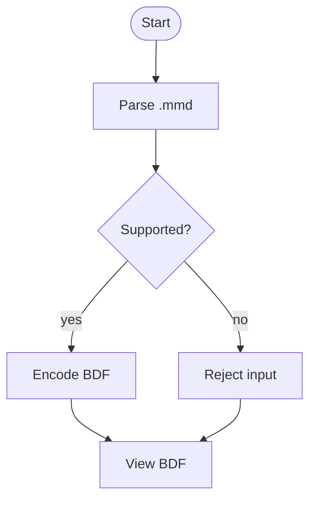

# Visio・draw.io・Mermaid・Excalidraw

Visio と draw.io（diagrams.net）の図は、線で結んだ図形を、作図ツール自身がページに分けて管理しているものです。BDF はこの構造を崩さず、ファイルの中の 1 ページを BDF の 1 ページにし、ビューアはタブで切り替えます。PDF に書き出したときのように 1 本のページの連なりに敷き直すことはしません。

Mermaid と Excalidraw は、bdf.mbt の**プラグイン API**で変換します（この 2 つは上流 BDF の文書にはない、bdf.mbt の追加です）。Mermaid は Mermaid 本体の互換実装ではなく、このリポジトリが定めた**静的なフローチャートの一部**だけを読みます。Excalidraw は**基本図形・矢印・プレーンテキスト**だけで、手書き風の線や独自フォントは対象外です。どちらも、ファイルをネットワークに送らず、埋め込まれた外部リソースを読みません。

## 試してみる

[ビューア](https://f4ah6o.github.io/bdf.mbt/viewer/)にファイルをドロップするか、このサイトに置いてあるサンプルを試してください。draw.io の図（[multipage.drawio](https://f4ah6o.github.io/bdf.mbt/viewer/?file=samples/multipage.drawio)、[aws.drawio](https://f4ah6o.github.io/bdf.mbt/viewer/?file=samples/aws.drawio)、[labels.drawio](https://f4ah6o.github.io/bdf.mbt/viewer/?file=samples/labels.drawio)、[showcase.drawio](https://f4ah6o.github.io/bdf.mbt/viewer/?file=samples/showcase.drawio)）、Mermaid のフローチャート（[flowchart.mmd](https://f4ah6o.github.io/bdf.mbt/viewer/?file=samples/flowchart.mmd)）、Excalidraw の図形（[shapes.excalidraw](https://f4ah6o.github.io/bdf.mbt/viewer/?file=samples/shapes.excalidraw)）です。Visio の図面はこのサイトのサンプルには置いていません（変換器は `converter/visio` にあります）。

ビューアは、Visio・draw.io とその他の組み込み形式を `native_converter_worker.js` に、Mermaid・Excalidraw をプラグイン API の Worker に渡します。プラグインの Worker は、その拡張子を最初に開いたときだけ起動します。プラグインが失敗しても、組み込み形式の変換はそのまま動きます。

## Visio（.vsdx）

`converter/visio` は Visio 2013 以降のパッケージ（.vsdx、.vsdm、.vstx、.vstm）を、1 つの ShapeSheet モデルに読みます。Visio 2003〜2010 の XML 図面（.vdx、.vtx）と、バイナリの .vsd 形式は読みません。

前景ページごとに 1 ページを作り、大きさはそのページ自身の用紙幅と縮尺から決めます。背景ページ（Visio の図面は背景ページを連鎖させられます）は共有の背景レイヤーになり、それを使うすべてのページで 1 回だけ描いて使い回します。図形は持たないセルをマスターとそのスタイルから継承し、動的テーマが決めるセルはテーマと図形のクイックスタイルから解決します。色、線・塗りのスキーム、コネクタとして扱われる図形が使うコネクタ専用のスキームも同様です。ジオメトリの各行、塗りのパターン、グラデーション、線種、45 種すべての矢印を描き、Visio がファイルには保存せずコネクタのルーティングから求める線の飛び越しも同じ手順で計算します。テキストは PowerPoint の変換器と同じ DrawingML のテキストエンジンでレイアウトし、フォントはサブセットの WOFF2 として埋め込みます。

`converter/visio` に `-param` オプションはありません。

詳細は[design.md §3.8](../design.md#38-visio--bdf-変換器convertervisioの構造)を参照してください。

## draw.io

`converter/drawio` は draw.io 自身の SVG や PDF の書き出しを経由せず、図の mxGraphModel XML から直接 BDF の命令を作ります。読むのは `.drawio` ファイル（draw.io が圧縮したページも）と、図を埋め込んだ `.drawio.svg` / `.drawio.png` の書き出しです。

ページごとに BDF の 1 ページを作るので、ビューアは表計算ソフトのシートと同じようにタブでページを切り替えます。draw.io のレイヤーはページのレイヤー Object に、ページへのリンクは `#view=` リンクになります。セルの配置、エッジの経路（直交・エルボーなどの mxGraph のエッジスタイルと図形の外周）、図形・矢印・ステンシル、HTML ラベルの折り返しと書式は draw.io（mxGraph）自身の描画処理をそのまま移植したものです。draw.io は計算したエッジの経路をファイルに保存しないため、これがそのまま描画の見た目を決めます。ステンシルライブラリ（flowchart、basic、arrows、AWS、BPMN、ネットワーク図など）は draw.io 自身のステンシル XML から埋め込み、フォントは PowerPoint と同じ方法でサブセットを埋め込みます。AWS の図は現行の AWS アイコンで描き、古い世代のアイコンで描かれた図も現行の対応するアイコンに置き換えて描きます。数式の組版を有効にすると（`math=1`）、ラベルの LaTeX を Word や PowerPoint の数式と同じエンジンで組みます。手書き風の表示（`sketch=1`）は、手書き風にはせず通常の描画にします。

| オプション | 値 | 既定 |
|---|---|---|
| `-param border=` | 各ページの図のまわりの余白（ピクセル） | `10`（`0` で余白なし） |

詳細は[design.md §3.11](../design.md#311-drawio--bdf-変換器converterdrawioの構造)を参照してください。

### draw.io のラベルの数式

「その他 → 数式組版」をオンにした図（モデルに `math="1"`）では、draw.io が MathJax に渡すのと同じ区切りの LaTeX を組みます。`$$ … $$` と `\[ … \]` は独立した行、`\( … \)` は行の中です。バッククォートの AsciiMath は組まずに警告を出します。

```xml
<mxGraphModel math="1">
  <root>
    <mxCell id="2" value="解は \(x = \frac{-b \pm \sqrt{b^2 - 4ac}}{2a}\)" style="rounded=1;whiteSpace=wrap;html=1;" vertex="1" parent="1">
      <mxGeometry x="40" y="40" width="260" height="60" as="geometry"/>
    </mxCell>
  </root>
</mxGraphModel>
```

サンプルは [`converter/drawio/testdata/math.drawio`](https://github.com/shibukawa/bdf/blob/main/converter/drawio/testdata/math.drawio) です。組み方は [Word・HTML・Markdown の数式](document.md#数式)と同じです。

## Mermaid（.mmd・.mermaid）

Mermaid の変換器は `plugin/adapters/mermaid` のプラグインです。Mermaid 本体の JavaScript エンジンは読み込まず、UTF-8 のテキストを行単位で走査する、上限付きの実装です。`eval`・`new Function`・DOM・ネットワークは使いません。Mermaid の全機能を再現するものではなく、**次の静的なフローチャートの一部**だけを読みます。それ以外は、何を断ったかを名指しするエラーで拒否します。途中まで読んで推測することをしません。

### 読める構文

| 項目 | 読める形 |
|---|---|
| ヘッダー | `flowchart` または `graph`（小文字のみ）。続けて方向 `td`・`tb`・`lr`・`rl`（大文字小文字を問わない、既定は `td`）。`flowchart` だけでも可 |
| 囲み | 全体を囲む 2 行だけのフェンス（1 行目が mermaid の開始フェンス、最終行が閉じフェンス）。それ以外のフェンスや HTML は拒否 |
| ノード | `id`、`id[label]`（四角）、`id(label)`（角丸）、`id([label])`（スタジアム）、`id{label}`（ひし形）、`id{{label}}`（六角形） |
| ノード ID | 文字（どの文字体系でも）・数字（どの文字体系でも）・`_`・`-`。先頭は文字か `_`。最大 64 コードポイント |
| ラベル | プレーンな Unicode テキスト。最大 256 UTF-8 バイト。`id["plain text"]` の引用符付きも可。引用符付きなら `[` や `]` をラベルに含められる |
| エッジ | `---`、`-->`、`-.->`、`==>`。ラベル付きは `A -- text --> B`、`A -. text .-> B`、`A == text ==> B`、`A -->|text| B` |
| チェーン | `A --> B --> C` のように 1 行でつなげる。矢印ごとに 1 本として数える |
| コメント | 行全体の `%% ...`。CR・CRLF・空行は可 |

ノード ID とラベルは Unicode です。日本語のラベル（`開始 --> 処理中` のような裸の ID も、`[処理中]` のような角括弧のラベルも）は対象です。ただし、制御文字、単独のサロゲート、双方向の上書き、`<`・`>`・`&`・バッククォート（HTML と実体参照）、`javascript:`・`data:` の URL は拒否します。

### 決まった手順で組むレイアウト

Mermaid のレイアウトエンジンを呼ぶのではなく、次の決まった手順で組みます。同じ入力からは、同じページができます。

- 各ノードの深さは `1 + 親の最大の深さ`。親の無いノードが深さ 0 です。反復回数はノード数で上限を切るので、循環があっても有限回で止まります（循環したノードは上限で深さが固定され、警告が出ます）。
- 同じ深さの中では、最初に現れた順に並べます。
- ノードの箱は 160×48 pt です。`td`・`tb` では `x = 40 + 層内の位置 × 200`、`y = 40 + 深さ × 120`。`lr` では `x = 40 + 深さ × 200`、`y = 40 + 層内の位置 × 88`。`rl` は `lr` を左右反転します。
- ひし形は 192×96 の菱形、六角形は 192×96 の輪郭を、同じ 160×48 の箱の上に描きます。
- エッジは直線の折れ線です。ノードの輪郭（ひし形・六角形は実際の多角形、それ以外は 160×48 の箱）で切り、ノードの下に描きます。エッジのラベルは最後に上へ描きます。
- 色は固定です（ノードの塗り `#f9fafb`、線 `#1f2937`、ひし形 `#fef9c3`、六角形 `#e0f2fe`、エッジ `#4b5563`、ラベル `#374151`）。
- ページは、描いたもの全体の外接矩形に 40 pt の余白を足した大きさです。最小座標が 40 pt より小さければ、すべての図形を平行移動します。

これは Mermaid の見た目を再現するものではありません。**決まった近似**であることを、変換結果の警告にも出します。

### 読めないもの（明示的に拒否）

- フローチャート以外の図: `sequenceDiagram`、`classDiagram`、`stateDiagram`・`stateDiagram-v2`、`erDiagram`、`gantt`、`pie`、`journey`、`gitGraph`、`mindmap`、`timeline`、`quadrantChart`、`requirementDiagram`、`sankey`、`block`、C4 系。
- `subgraph`、`end`、`classDef`、`class`、`click` とコールバック、`call`、`init`、`require`、`linkStyle`、`style`、行中の `direction`、`%%{...}%%` のディレクティブ。
- 対応していないノードの形: 円柱 `id[(...)]`、サブルーチン `id[[...]]`、円 `id((...))`、非対称 `id>...]`。
- HTML のラベルと実体参照、`javascript:`・`data:` の URL、`--o`・`--x`・`o--`・`x--`・`---|...|` などの矢印、行の途中のコメント、空の ID、ID の規則に合わないもの、256 バイトを超えるラベル、`-- text -->` の空ラベル、閉じていない図形・引用符・パイプ・ラベル付きエッジ、不正な UTF-8。
- Mermaid の JavaScript エンジン、DOM、ネットワーク、`eval` は使いません。任意の JavaScript や HTML を実行することはありません。

### 上限

入力 1 MiB、4096 行、512 ノード、2048 エッジ、1 行 8 トークン、ラベルの合計 100000 文字です。上限を超えると `too-large`、内容が規則に合わないと `invalid-input` のエラーになります。

### 例



このサイトのサンプルは [`site/samples/flowchart.mmd`](https://github.com/f4ah6o/bdf.mbt/blob/main/site/samples/flowchart.mmd) です。ビューアで開くと、レイアウトが近似であることの警告がステータスに出ます。

## Excalidraw（.excalidraw・.excalidraw.json）

Excalidraw の変換器は `plugin/adapters/excalidraw` のプラグインです。Excalidraw のエディタが保存する JSON（`{ "type": "excalidraw", "elements": [...] }`）と、`type` の無い `{ "elements": [...] }` を読みます。要素を、共有の図形プリミティブ（四角・楕円・多角形・折れ線・テキスト）に直し、BDF にします。Excalidraw の描画エンジンは読み込みません。

### 読める要素

| 項目 | 読める形 |
|---|---|
| 図形 | `rectangle`、`ellipse`、`diamond` |
| 線 | `line`、`arrow`。直線の折れ線。`arrow` は始点・終点の矢印（`arrow`・`triangle`・`none`） |
| テキスト | `text`。プレーンテキスト、複数行、左・中央・右揃え。`fontFamily` の 2 は Helvetica、3 は等幅 |
| 塗りと線 | 単色の塗り（`fillStyle: "solid"`）、線の色、線の太さ、`dashed`・`dotted` の線種 |
| 透明度 | Excalidraw のパーセント（0〜100、省略時は 100）。BDF のアルファに直す |
| 回転 | 要素の `angle`（ラジアン）。矢印の軸と矢じり、複数行のテキストは、元の要素の同じ支点で回る |
| 重なり順 | `elements` の配列の順。後ろの要素が上に描かれる |
| 削除済み | `isDeleted: true` の要素は描かない |

### 対象外（警告を出して、できる範囲で描く）

- **手書き風の線**: `roughness` が 0 以外でも、手書きの揺れは付けずにまっすぐ描きます（警告）。
- **スケッチのハッチ塗り**: `hachure`・`cross-hatch`・`zigzag` などの塗りは塗らずに描きます（警告）。
- **フリーハンド**: `freedraw` は描きません（警告）。
- **埋め込み画像とリンクされたリソース**: 画像は読み込まず、埋め込みません（警告）。外部の URL を取得することもありません。
- **独自フォント**: Virgil・Excalifont などの独自フォントは対象外で、Helvetica で描きます（警告）。
- **角丸**: 四角の角丸は `min(16, 短い辺 / 4)` の近似です（警告）。
- **要素のハイパーリンク**: 描きません（警告）。
- **フレームの切り抜き**: 適用しません（警告）。
- **縦揃え**: `top` 以外は近似です（警告）。
- **透明度 100 超**: 100 に丸めます（警告）。
- **対応していない色**: `#1e1e1e` で描きます（警告）。
- **対応していない要素**: 警告を出して飛ばします。
- **曲がった矢印・エルボー**: 直線の折れ線で近似します（警告）。

### 上限

入力 8 MiB、10000 要素、線・矢印 1 本あたり 500 点、プリミティブ 20000、点の合計 100000、テキストの合計 200000 文字、1 行 4096 文字、フォントサイズ 1000 pt、線の太さ 10000、座標の絶対値 1e6 です。ページの大きさは、描いたもの全体の外接矩形に 16 pt の余白を足したものです。

### 例

```json
{
  "type": "excalidraw",
  "elements": [
    {
      "type": "rectangle",
      "x": 40, "y": 40, "width": 180, "height": 80,
      "strokeColor": "#1e1e1e",
      "backgroundColor": "#e0f2fe",
      "fillStyle": "solid",
      "strokeWidth": 2,
      "strokeStyle": "solid",
      "roughness": 0,
      "opacity": 100
    },
    {
      "type": "text",
      "x": 40, "y": 150,
      "text": "Basic shapes and plain text",
      "fontSize": 20,
      "fontFamily": 2,
      "textAlign": "left",
      "strokeColor": "#1e1e1e"
    }
  ]
}
```

このサイトのサンプルは [`site/samples/shapes.excalidraw`](https://github.com/f4ah6o/bdf.mbt/blob/main/site/samples/shapes.excalidraw) です。

## プラグイン API と資料

Mermaid と Excalidraw は、bdf.mbt のバージョン付きプラグイン API（API バージョン 1）のアダプタです。プラグインは Worker の起動時にコードとして登録し、メッセージで受け取った記述子を評価することはありません。変換は同期の `detect` と非同期の `convert` で、入力は上限付きのプリミティブに直してから、共有の BDF エンコーダに渡します。

- [図のプラグインの設計と範囲](https://github.com/f4ah6o/bdf.mbt/blob/main/docs/diagram-plugins.md) — 共有プリミティブ、エンコーダの契約、独立したリーダーでの検証、対象外の一覧
- [ファイル形式プラグイン API](https://github.com/f4ah6o/bdf.mbt/blob/main/docs/format-plugin-api.md) — API バージョン 1、検出の順序、オプションと結果の検証、ストリームの寿命
- [bdf.mbt パッケージの README](https://github.com/f4ah6o/bdf.mbt/blob/main/plugin/library/README.md) — npm からの導入、`bdf.mbt/workers/plugin`、`bdf.mbt/plugin/adapters/*`、下流の Worker を作るエミッタ
- [npm の bdf.mbt 2026.11.2](https://www.npmjs.com/package/bdf.mbt/v/2026.11.2) — この 2 つのアダプタを含む公開パッケージ

`bdf.mbt/workers/plugin` の既成の Worker は、DocuWorks（`.xdw`・`.xbd`）と、この 2 つの図のアダプタを登録します。このサイトのビューアは、図の 2 つだけを登録した `plugin_converter_worker.js` を使い、Visio・draw.io とその他の形式は `native_converter_worker.js` に残しています。どちらも同じ変換のメッセージ形式なので、`bdf_create_native_converter` のクライアントでそのまま動きます。2 つのホストの間に自動の振り分けはありません。振り分けは、呼ぶ側（このサイトではビューア）が拡張子で決めます。

変換はブラウザの中だけで行います。ファイルをネットワークに送ることも、埋め込まれた外部リソースを読み込むこともありません。
